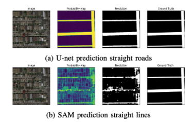

# Road Segmentation — U-Net with K-Fold Cross-Validation


Binary semantic segmentation of aerial road imagery using a U-Net architecture trained with 2-fold cross-validation.

**Team:** Mylène Berruyer · Ghalia Bennani · Mehdi Hajoub — EPFL CS-433, 2023

---

## Results 

| Model | F1 Score | Accuracy | IoU |
|-------|----------|----------|-----|
| **U-Net (ours)** | **0.826 ± 0.024** | **0.924 ± 0.011** | **0.705 ± 0.035** |
| SAM ViT-H (zero-shot) | 0.767 | 0.891 | 0.623 |
| U-Net from scratch | 0.798 | 0.907 | 0.670 |

> **Key finding:** Task-specific fine-tuning with CosineAnnealingLR outperforms a zero-shot foundation model (SAM) on narrow aerial imagery — demonstrating that domain adaptation beats general-purpose models for specialized segmentation tasks.

### Results (2-Fold Cross-Validation)


| Metric | Mean | Std |
|--------|------|-----|
| **F1 Score** | **0.826** | ±0.024 |
| **Pixel Accuracy** | **0.924** | ±0.011 |
| IoU | 0.705 | ±0.035 |
| Dice | 0.826 | ±0.024 |
| Avg inference time | 0.45s / image | ±0.10 |

Best checkpoint: `model_epoch39_fold_0.pth` (val loss 0.2745)

## Visual Results



*Left to right: input image, probability map, binary prediction, ground truth.  
Top: U-Net (ours) — clean road segmentation. Bottom: SAM zero-shot — fails on aerial imagery.*

---

## Method

### Architecture
U-Net trained end-to-end on 400×400 aerial RGB images with binary road masks.

### Training Setup
- **Optimizer:** Adam (lr = 1e-4)
- **Scheduler:** CosineAnnealingLR (T_max = 50 epochs)
- **Loss:** Binary Cross-Entropy
- **Batch size:** 10 | **Epochs:** 50 | **Folds:** 2
- **Hardware:** Google Colab T4 GPU

---

## Run Inference

```bash
# 1. Set up environment
conda env create -f environment.yml
conda activate road-seg

# 2. Place your model checkpoint at:
#    source_code/models/unet/Results/model_epoch39_fold_0.pth

# 3. Run prediction on the 50 test images
python run.py
# Predictions saved to: source_code/models/unet/Results/preds/
# Submission file:      dummy_submission.csv
```

---

## Project Structure

```
road-segmentation/
├── models/
│   └── unet/
│       └── unet_class.py        # U-Net architecture
├── utils/
│   └── mask_to_submission.py    # AICrowd submission formatter
├── run.py                       # Inference entry point
├── helpers.py                   # Preprocessing & utilities
├── environment.yml              # Conda environment
└── Project_2-3.pdf              # Full report with ablation study
```

---

## Report

Full methodology, architecture choices, training curves, and error analysis in [`Project_2-3.pdf`](./Project_2-3.pdf).
```
